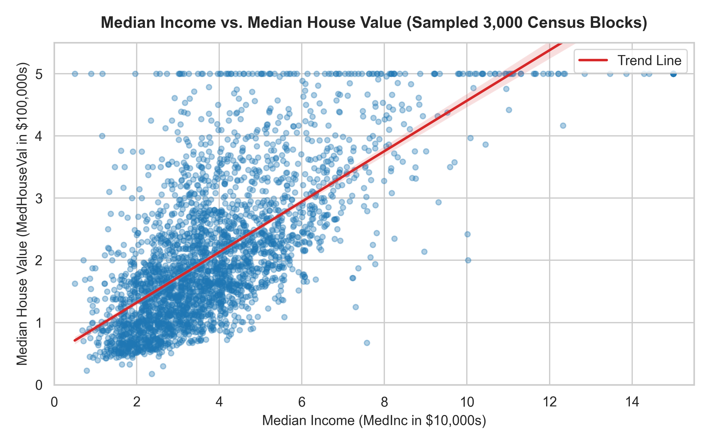
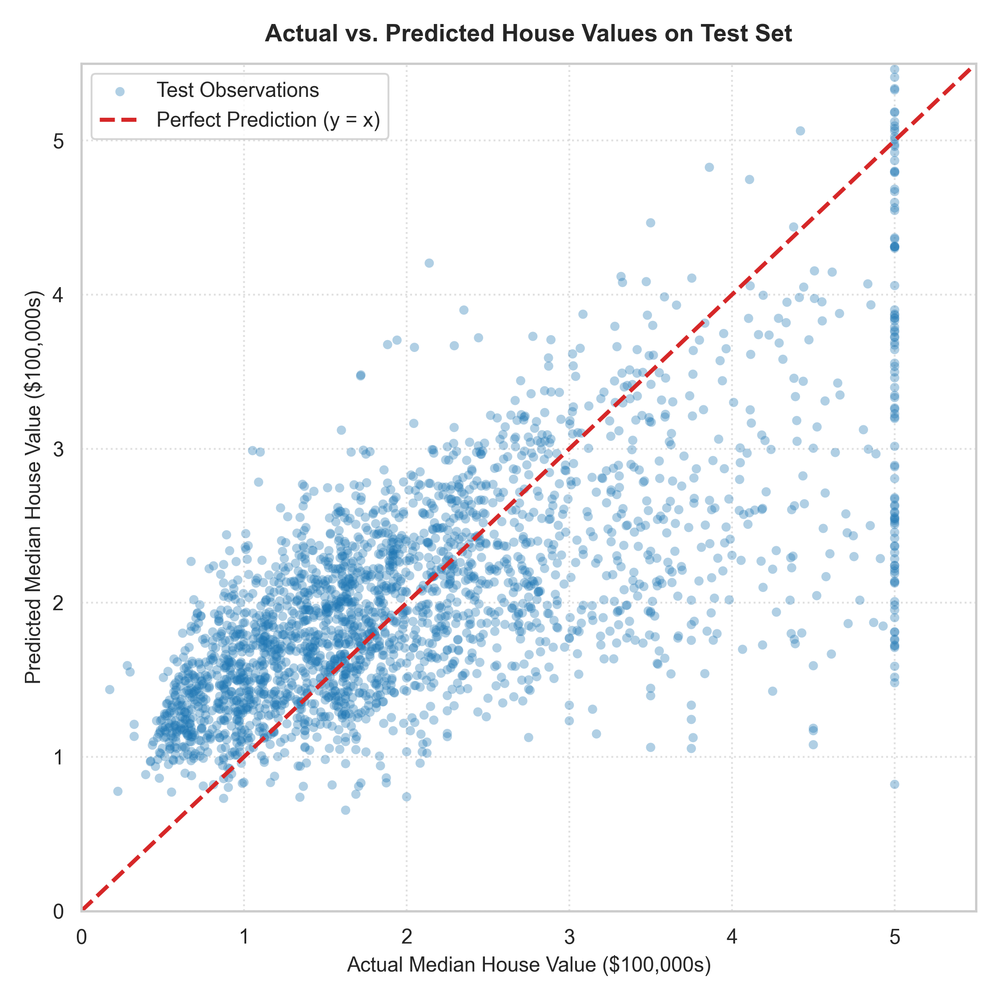

# Simple House Price Prediction Using Linear Regression
## Machine Learning CIE 2 — Unit II: Supervised Learning (Regression)


---

## 📌 Project Overview
This repository contains a complete, verified, and beginner-friendly Machine Learning project for **Activity 2: Simple House Price Prediction — Unit II: Supervised Learning: Regression** (CIE 2).

The project implements a **Simple Linear Regression** workflow to predict continuous California house prices from neighborhood median income, assesses data quality, splits data without leakage, trains the model using Ordinary Least Squares (OLS), quantifies out-of-sample performance across standard evaluation metrics, visualizes actual vs. predicted values, and predicts property values for new inputs.

---

## 👨‍🏫 Faculty Reference & Acknowledgement
> “This project was completed as part of the Machine Learning CIE 2 activity. Faculty reference and Machine Learning learning resources: [https://github.com/Princy2129](https://github.com/Princy2129)”

---

## 📊 Dataset Description & Source
- **Dataset**: [California Housing Dataset (Scikit-learn Real-World Datasets)](https://scikit-learn.org/stable/datasets/real_world.html#california-housing-dataset)
- **Origin**: Derived from the 1990 U.S. Census by Pace and Barry.
- **Dimensions**: **20,640 rows** (census block groups) and **9 numerical columns**.
- **Input Feature ($X$)**: `MedInc` — Median income in census block group (expressed in units of **$10,000**, e.g., $8.3252 = $83,252).
- **Target Variable ($y$)**: `MedHouseVal` — Continuous median house value for households within a block group (expressed in units of **$100,000**, e.g., $4.526 = $452,600).

### Why `MedInc` as the Single Predictor?
Neighborhood median household income directly reflects purchasing power and mortgage qualification capacity. While housing values correlate strongly with income, **visual and statistical association alone does not establish causation**.

---

## 🛠️ Technology Stack
- **Language**: Python 3.12+
- **Data Manipulation**: Pandas, NumPy
- **Data Visualization**: Matplotlib, Seaborn
- **Machine Learning**: Scikit-learn (`LinearRegression`, `train_test_split`, `metrics`)
- **Interactive Environment**: Jupyter Notebook / Google Colab
- **Report Generation**: ReportLab PDF Engine

---

## 🚀 Repository Structure
```text
ML-CIE2-House-Price-Prediction-22/
├── house_price_prediction.ipynb   # Executed Jupyter Notebook with all outputs
├── README.md                      # Comprehensive project documentation
├── requirements.txt               # Dependencies required to run the project
├── images/                        # Generated high-resolution visualization charts
│   ├── eda_scatter_medinc_vs_medhouseval.png
│   ├── eda_distribution_target.png
│   ├── eda_correlation_heatmap.png
│   └── actual_vs_predicted_scatter.png
└── reports/
    └── Activity_Report.pdf        # Formal academic PDF submission report
```

---

## 🔍 Data Quality Inspection Summary
| Check | Finding | Action Taken |
| :--- | :--- | :--- |
| **Missing Values** | 0 missing values across all columns (0.00%) | None required (no imputation needed) |
| **Duplicate Records** | 0 exact duplicate rows | None required |
| **Data Types** | All 9 columns are continuous 64-bit floats (`float64`) | Compatible directly with regression |
| **Target Distribution** | Capped at 5.0 ($500,000) for 965 blocks (4.68%) | Retained all records as per benchmark |

---

## ⚙️ Train-Test Split & Reproducibility
- **Split Ratio**: 80% Training (16,512 block groups) / 20% Testing (4,128 block groups)
- **Random Seed**: `random_state=42`
- **Methodology**: The model was fitted **strictly on `X_train` and `y_train`**. The test partition was isolated until final model evaluation to prevent data leakage.

---

## 📈 Trained Model Parameters & Mathematical Equation
The Ordinary Least Squares (OLS) estimator yielded the following parameters:
- **Slope Coefficient ($\beta_1$)**: `0.4193`
- **Y-Intercept ($\beta_0$)**: `0.4446`

### Fitted Regression Equation:
$$\text{Predicted MedHouseVal} = 0.4446 + (0.4193 \times \text{MedInc})$$

- **Slope Interpretation**: For every 1-unit increase in `MedInc` ($10,000 increase in median household income), the predicted median house value increases by approximately **0.4193 units** (approx. **$41,933.85**).
- **Intercept Interpretation**: At `MedInc = 0`, the predicted baseline target is **0.4446 units** (approx. **$44,459.73**). Since zero-income census blocks do not exist, the intercept anchors the linear geometry.

---

## 🏆 Verified Model Evaluation Metrics
All metrics were computed strictly on the held-out test set ($N = 4,128$ observations):

| Evaluation Metric | Dataset Scale Units | Dollar Equivalent ($) | Plain-English Interpretation |
| :--- | :---: | :---: | :--- |
| **Mean Absolute Error (MAE)** | **0.6299** | **$62,990.87** | On average, predictions deviate from actual median values by ~$63k. |
| **Mean Squared Error (MSE)** | **0.7091** | **$7,091,157,771.77 ($^2)** | Average squared error; penalizes larger errors more heavily. |
| **Root Mean Squared Error (RMSE)**| **0.8421** | **$84,209.01** | Standard deviation of unexplained residuals in target units. |
| **Coefficient of Determination ($R^2$)** | **0.4589** | **45.89%** | 45.89% of target variance is explained by median income alone. |

> **Academic Note**: We do not falsely claim near-perfect accuracy. An $R^2$ of 0.4589 indicates a solid univariate baseline, while correctly acknowledging that 54.11% of price variability depends on omitted geographic and structural factors.

---

## 🖼️ Visualizations

| Exploratory Regression Scatter | Actual vs. Predicted (Test Set) |
| :---: | :---: |
|  |  |

- **Points near the $y = x$ reference line**: Represent accurate predictions where predicted values closely match census ground truth.
- **Dispersion**: Vertical spread illustrates variance attributable to factors not captured by income alone (e.g., coastal proximity, house age).
- **Horizontal Capping**: The ceiling at `MedHouseVal = 5.0` reflects census top-coding.

---

## 🔮 Demonstration of a New Prediction
To illustrate model deployment for a prospective new neighborhood:
- **Input Feature**: `MedInc = 4.5` (representing a median household income of **$45,000**)
- **Predicted MedHouseVal**: `2.3316`
- **Predicted Dollar Price**: **$233,162.05**

*Note: This is an illustrative macroeconomic estimate for an entire census block group, not an appraised individual property listing.*

---

## ⚠️ Limitations & Real-World Considerations
1. **Univariate Limitation**: Only one feature (`MedInc`) was used. Real-world property values are determined by multiple factors (ocean proximity, square footage, bedroom count, school districts).
2. **Linear Assumption**: Assumes a constant proportional rate of price change across all income brackets.
3. **Census Aggregates**: Data represents geographical block groups (averaging ~1,425 residents), not individual house sale deeds.
4. **Temporal Context**: Data originated from the 1990 U.S. Census; nominal dollar figures should not be used as modern real estate valuation quotes.

---

## 📋 Evaluation Scheme Compliance Checklist (5 Marks)
- [x] **Criterion 1 (1 Mark)**: Dataset understanding, feature/target selection, and documentation of units.
- [x] **Criterion 2 (1 Mark)**: 80/20 train-test split (`random_state=42`) and OLS model training.
- [x] **Criterion 3 (1 Mark)**: Test-set predictions and metrics table (MAE, MSE, RMSE, $R^2$).
- [x] **Criterion 4 (1 Mark)**: Visualizations (EDA plots, actual-vs-predicted with $y=x$ reference line).
- [x] **Criterion 5 (1 Mark)**: New example prediction and critical limitations discussion.

---

## 💻 Execution Instructions

### Local Environment Setup:
1. Clone this repository:
   ```bash
   git clone https://github.com/maddrghule22/ML-CIE2-House-Price-Prediction-22.git
   cd ML-CIE2-House-Price-Prediction-22
   ```
2. Install required dependencies:
   ```bash
   pip install -r requirements.txt
   ```
3. Launch Jupyter Notebook:
   ```bash
   jupyter notebook house_price_prediction.ipynb
   ```

### Google Colab Execution:
1. Open [Google Colab](https://colab.research.google.com/).
2. Select **File > Open Notebook > GitHub** and paste this repository URL.
3. Run all cells sequentially via **Runtime > Run all**.

---

## 🌐 Verifying Repository Public Visibility
To verify that this repository is accessible to evaluators without login prompts:
1. Open an Incognito / Private browsing window.
2. Navigate to: `https://github.com/maddrghule22/ML-CIE2-House-Price-Prediction-22`
3. Ensure the repository loads publicly with all files visible.
